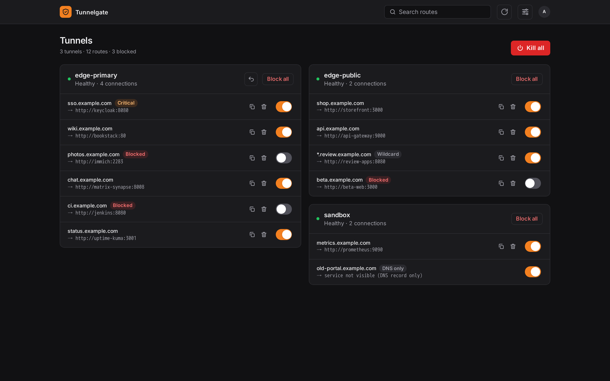

# Tunnelgate

[](https://github.com/gabriel-lando/tunnelgate)
[](https://hub.docker.com/r/gabriellando/tunnelgate)
[](https://hub.docker.com/r/gabriellando/tunnelgate/tags)
[](https://hub.docker.com/r/gabriellando/tunnelgate/tags)

- **Source:** <https://github.com/gabriel-lando/tunnelgate>
- **Image:** `docker pull gabriellando/tunnelgate` ([Docker Hub](https://hub.docker.com/r/gabriellando/tunnelgate))

A small, internal-only dashboard that works as a **kill switch** and route manager for
[Cloudflare Tunnels](https://developers.cloudflare.com/cloudflare-one/connections/connect-networks/).

- Lists every tunnel (cloudflared instance) and its routes, discovered live from the Cloudflare API.
- Blocks or allows external access per route, per tunnel, or for everything at once.
- Clones an existing route (same tunnel) to create a new public hostname, and removes routes.
- Undoes the last config change of a tunnel from a local snapshot.
- Signs users in with OIDC (e.g. Authelia), requires an allowed group and MFA; or, without an identity
  provider, with a single username and password.
- Responsive UI (desktop and mobile), installable as a PWA, English and Portuguese (Brazil).

Nothing about your tunnels is hardcoded or stored locally: Cloudflare is the source of truth.



## How blocking works

Each zone gets **one** WAF custom rule owned by Tunnelgate (description `tunnelgate-managed`):

```
(lower(http.host) in {"vault.example.com" "git.example.com"})
  or ends_with(lower(http.host), ".apps.example.com")      → action: block
```

Toggling a route adds or removes its hostname from that rule; wildcard routes (`*.apps.example.com`)
become an `ends_with` clause. The tunnel, ingress rules and DNS are not touched, so unblocking is instant
and lossless. When nothing is blocked the rule is disabled. Every write is read back and retried, under a
lock shared by the web app and the CLI.

"Kill all" and "Block all" keep going when one zone fails and always report the routes that are still
reachable (the UI shows them, the CLI exits with code 3).

Limitations:

- Routes in zones the API token cannot access are shown read-only and reported as not blocked.
- Blocking applies to traffic through Cloudflare only; internal (split-DNS) access is unaffected.
- A rule expression is limited to 4096 characters (roughly 150 hostnames per zone).
- Verify once against your zone that `GIT.example.com` and `git.example.com.` are blocked too
  (`curl -H 'Host: GIT.example.com' https://git.example.com`).

## Requirements

- Tunnels must be **remotely managed** (created in the Cloudflare dashboard and run with a token).
  Locally managed tunnels (`config.yml`) only appear through their DNS records and are read-only.
- An **account** API token (Manage Account › Account API Tokens; Tunnelgate verifies it as an account
  token) with two permission policies:

  | Policy scope   | Permission (search for it in the policy editor)        | Level | Shown in the summary as |
  | -------------- | ------------------------------------------------------ | ----- | ----------------------- |
  | Entire account | Cloudflare One / Zero Trust › **Argo Tunnel (Legacy)** | Edit  | Cloudflare Tunnel Write |
  | Specific zones | **DNS**                                                | Edit  | DNS Write               |
  | Specific zones | **Zone**                                               | Read  | Zone Read               |
  | Specific zones | **Zone WAF**                                           | Edit  | Zone WAF Write          |

  Nothing else is needed (not "Connectivity Directory", not the account-level DNS or ruleset groups).
  Restricting the token to your egress IP is a good extra if it is fixed.

  Scope the zone policy to the zones you want to manage. Widening the scope later only needs a new token and a
  restart; new zones appear automatically.

- An OIDC provider with PKCE and a `groups` claim (Authelia example in [`deploy/`](deploy/README.md#2-oidc-provider)),
  or a username and password for [password mode](#password-mode).

## Configuration

All configuration comes from environment variables (see [`.env.example`](.env.example)).

| Variable                                | Required         | Description                                                                                                                                             |
| --------------------------------------- | ---------------- | ------------------------------------------------------------------------------------------------------------------------------------------------------- |
| `CF_API_TOKEN`                          | yes              | Cloudflare API token (permissions above).                                                                                                               |
| `CF_ACCOUNT_ID`                         | yes              | Account that owns the tunnels.                                                                                                                          |
| `OIDC_ISSUER`                           | OIDC mode        | OIDC issuer URL, e.g. `https://auth.example.com`. Its hostname is always treated as a critical route.                                                   |
| `OIDC_CLIENT_ID` / `OIDC_CLIENT_SECRET` | OIDC mode        | OIDC client credentials.                                                                                                                                |
| `APP_URL`                               | yes              | Public URL of Tunnelgate (no path). Used for the redirect URI (`/auth/callback`), Origin checks and cookies.                                            |
| `ALLOWED_GROUPS`                        | OIDC mode        | Comma-separated groups allowed in (case-insensitive).                                                                                                   |
| `OIDC_REQUIRE_MFA`                      | no               | Default `true`. Requires the `amr` claim to show multi-factor sign-in.                                                                                  |
| `BASIC_AUTH_USERNAME`                   | password mode    | Username for [password mode](#password-mode).                                                                                                           |
| `BASIC_AUTH_PASSWORD_HASH`              | password mode    | Hash from `tunnelgate hash-password` (preferred).                                                                                                       |
| `BASIC_AUTH_PASSWORD`                   | password mode    | Plain-text password, instead of the hash.                                                                                                               |
| `CRITICAL_HOSTS`                        | no               | Extra hostnames that need confirmation before blocking.                                                                                                 |
| `SERVICE_ALLOWLIST`                     | no (recommended) | Patterns (`host` or `host:port`) that cloned routes may point to; see below. Loopback, link-local/metadata, this app and the issuer are always refused. |
| `SESSION_MAX_AGE`                       | no               | Session lifetime in seconds (default 8 hours, absolute).                                                                                                |
| `SESSION_SECRET`                        | no               | Development only (min. 32 characters). When unset, a random key is generated at every start (a restart signs everyone out). Setting it logs a warning.  |

Sessions are also registered server-side, so signing out invalidates the cookie immediately, and the
identity provider is asked to re-authenticate users whose last sign-in is older than `SESSION_MAX_AGE`.
Cloned routes are created **blocked** by default.

Users who authenticate but are not authorized (missing group or MFA) get an _Access denied_ page with
sign-out options instead of a login loop. The API answers `401` for "not signed in" and `403` for
"signed in but not allowed".

`SERVICE_ALLOWLIST` patterns: `*` and `?` match within one DNS label and never cross a dot or a colon,
a leading `*.` matches any number of subdomains (`*.lan` matches `nas.lan` and `a.b.lan`), and a pattern
without a port allows any port. Patterns made only of digits, dots and wildcards (`10.0.10.*`) match
IPv4 addresses only, never names such as `10.0.10.5.example.com`. A single `*` allows everything. When
the list is empty, a warning is logged at startup.

### Password mode

Without an identity provider, set `BASIC_AUTH_USERNAME` and a password instead of the `OIDC_*` variables
and `ALLOWED_GROUPS`. Users then get a sign-in form at `/login`.

```sh
docker run --rm -it docker.io/gabriellando/tunnelgate hash-password   # prompts, prints scrypt:...
docker run --rm docker.io/gabriellando/tunnelgate hash-password 'my password'   # non-interactive
```

Passing the password as an argument leaves it in your shell history; the prompt avoids that.

Put the output in `BASIC_AUTH_PASSWORD_HASH` (it contains no `$`, so it is safe in Compose env files), or
set the password itself in `BASIC_AUTH_PASSWORD`. If both are set, the hash is used and an error is logged.
If OIDC and password variables are both set, OIDC is used and an error is logged.

Password mode has no MFA. After 5 failed attempts, each further attempt waits exponentially longer (up to
5 minutes); every attempt is in the audit log. Keep the app on your internal network, and consider the
reverse proxy's forward auth as an extra layer.

## Deployment

Run the container on a host with **no external exposure**, behind your internal reverse proxy, on a
Docker network shared only with that proxy. [`deploy/`](deploy/README.md) has a step-by-step guide with a
compose file, a SWAG proxy config and an Authelia OIDC client.

The container runs as UID 10001, works with a read-only root filesystem, needs no capabilities and stores
only an SQLite file (audit log and config snapshots) in `/data`.

Make sure the container resolves your OIDC issuer through internal DNS, and that the firewall allows it to
reach the issuer and `api.cloudflare.com`.

### Break-glass CLI

If the identity provider or DNS is down, use the CLI from the host (anyone with a shell there already has
the token, so this adds no new access path):

```sh
docker exec tunnelgate tunnelgate status
docker exec tunnelgate tunnelgate block-all
docker exec tunnelgate tunnelgate unblock-all
```

Exit codes: `0` success, `1` Cloudflare error, `2` configuration error, `3` some routes are still reachable.

## Development

Backend (Python 3.15, [uv](https://docs.astral.sh/uv/)):

```sh
cd backend
uv sync
uv run pytest                 # unit + integration tests (Cloudflare and OIDC are mocked)
uv run ruff check . && uv run ruff format --check . && uv run mypy src
uv run python scripts/export_openapi.py   # after API changes; update frontend/src/lib/types.ts
```

Frontend (Node 24, pnpm via corepack):

```sh
cd frontend
pnpm install
pnpm dev                      # proxies /api and /auth to http://127.0.0.1:8000
pnpm check && pnpm lint && pnpm test && pnpm build
pnpm exec playwright install chromium && pnpm test:e2e
pnpm build && pnpm screenshots   # regenerates docs/ui/*.png from demo data (frontend/screenshots/)
```

To run the backend locally over plain HTTP, set `TUNNELGATE_ALLOW_INSECURE_HTTP=true` and a fixed
`SESSION_SECRET`.

Conventions: code, comments, commit messages and documentation are in English; only the UI is translated
(`frontend/src/lib/i18n/*.json`, add a language by adding a file and registering it in `index.svelte.ts`).

### Supply-chain rules

- Dependencies must be at least 3 days old: `exclude-newer = "3 days"` (uv) and
  `minimumReleaseAge: 4320` (pnpm). pnpm also blocks dependency install scripts.
- Lockfiles are enforced (`uv sync --locked`, `pnpm install --frozen-lockfile`).
- GitHub Actions are pinned by commit SHA; uv is installed in the image with `--require-hashes`;
  pnpm is pinned with its integrity hash in `packageManager`.
- Renovate ([`renovate.json`](renovate.json)) applies the same 3-day quarantine.
- A gitleaks pre-commit hook is available: `pre-commit install`.

## CI/CD

[`.gitea/workflows/ci.yml`](.gitea/workflows/ci.yml) runs on every push:

1. Lint and static checks: ruff, mypy, svelte-check, eslint, prettier, locale parity, actionlint, zizmor.
2. Secrets and dependencies: gitleaks (full history), OSV-Scanner, pip-audit, pnpm audit, Bandit, Semgrep, Hadolint.
3. Tests: pytest (coverage ≥ 80%, includes the OpenAPI contract check), vitest, Playwright E2E.
4. Image: build without pushing, Container Structure Test, smoke test, OWASP ZAP baseline, Syft SBOM,
   Grype (fails on fixable High/Critical). This job has no secrets.
5. Publish, a separate job that only runs for `main` (→ `latest`) and `v*` tags: loads the exact image
   that was scanned (checksum verified), pushes it, signs it and attaches the SBOM attestation with
   cosign, optionally uploads the SBOM to Dependency-Track and updates the Docker Hub description.

Pull requests on GitHub run [`.github/workflows/pr.yml`](.github/workflows/pr.yml): steps 1–4 above,
with a read-only token and no secrets, so contributions from forks are validated without being able to
publish anything. Gitea ignores `.github/workflows` because `.gitea/workflows` exists; keep the two
workflows in sync (both are linted on every run).

Python scanners are installed from the hash-locked [`ci/scanners.txt`](ci/scanners.txt), Go scanners
are verified by the Go checksum database. Protect the `main` branch and `v*` tags in Gitea so only you
can trigger the publish job. The artifact hand-off needs Gitea Actions support for
`actions/upload-artifact` v4+; if your Gitea is older, merge the publish steps back into the image job
and keep the `if:` guards.

Secrets used by the publish steps: `DOCKERHUB_USERNAME`, `DOCKERHUB_TOKEN`, `COSIGN_PRIVATE_KEY`,
`COSIGN_PASSWORD`, and optionally `DTRACK_URL` and `DTRACK_API_KEY`.

Verify a published image with:

```sh
cosign verify --key cosign.pub --insecure-ignore-tlog docker.io/gabriellando/tunnelgate:latest
```

## Security

Report issues privately to the maintainer.
